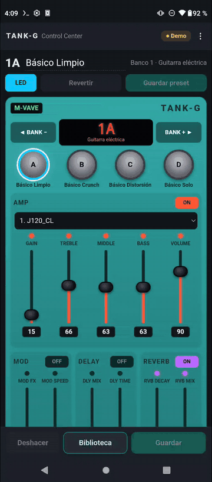
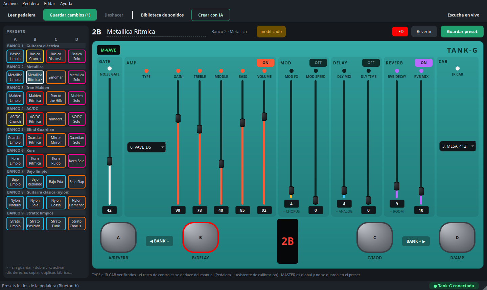
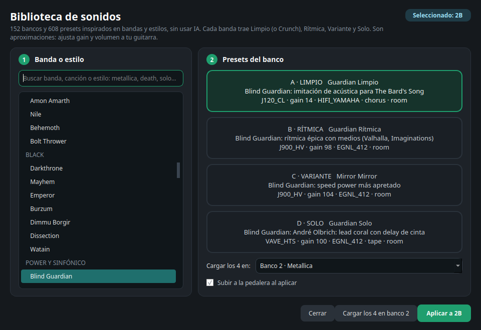
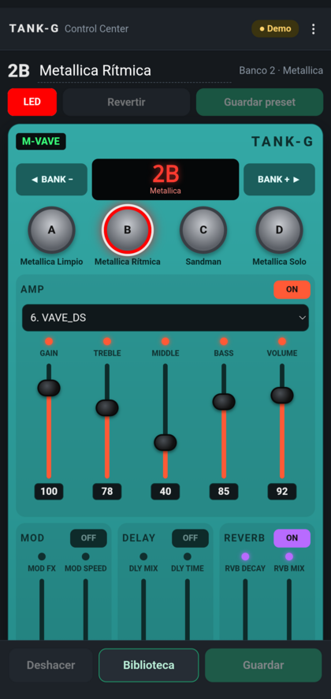
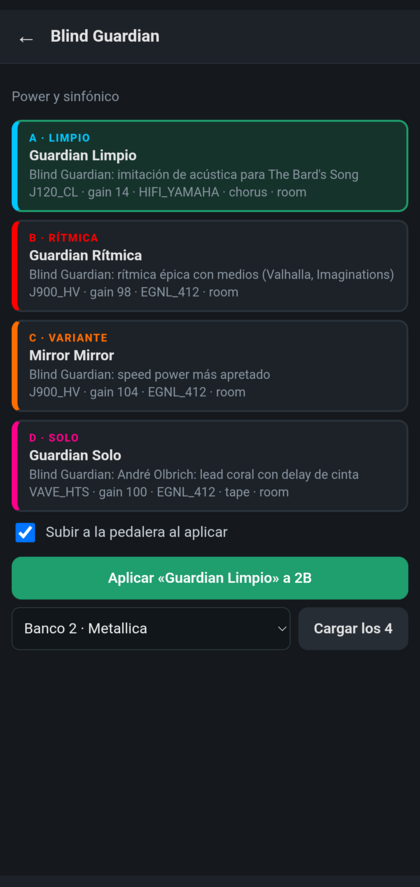
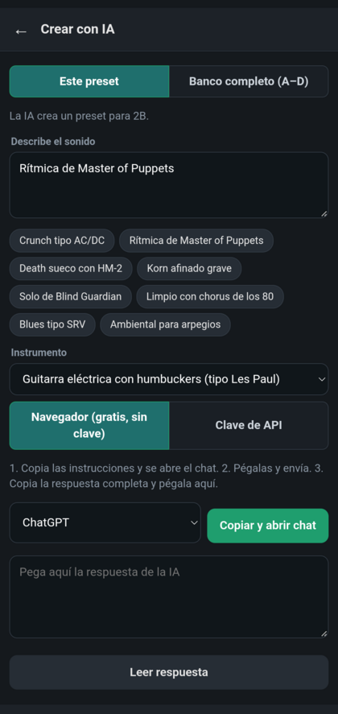

# Tank-G Control Center — descargas

Editor de presets para la pedalera **M-VAVE Tank-G** en **Windows, Linux y Android** (teléfono y
tablet), por **USB** o, en la Tank-G v2, por **Bluetooth**. Este repositorio solo contiene los
instaladores: las apps se actualizan solas desde aquí.

**[Descargar la última versión](https://github.com/CamiloFerreira/tankg-control-center-releases/releases/latest)**

  
  &nbsp;
  

| Sistema | Archivo |
|---|---|
| Windows 10/11 | `TankG-windows-x64.exe` |
| Linux x86_64 | `TankG-linux-x86_64` (`chmod +x` y ejecutar) |
| Android 6+ (teléfono o tablet) | `TankG-android.apk` — USB-OTG o Bluetooth |

## Qué hace

- Lee y guarda los 36 presets con verificación, con una pedalera virtual igual al panel real.
- **Biblioteca de sonidos** sin IA: más de 150 bancos y 600 presets de bandas y estilos (Limpio,
  Rítmica, Variante y Solo por banda), más bancos para bajo, guitarra clásica, Strato y Les Paul.
- **Crear con IA**: describe el sonido y la IA arma el preset o el banco (gratis por el navegador o
  con clave de API); abre la app de Claude/ChatGPT/Gemini si la tienes.
- Backups automáticos, importar/exportar presets y bancos, escucha en vivo, nombres, color del LED.
- Se actualiza sola en las tres plataformas.

| Biblioteca | Crear con IA | Android | Biblioteca en Android | IA en Android |
|---|---|---|---|---|
|  |  |  |  |  |

Comprueba cada descarga con `SHA256SUMS`. En Android, el sistema pide confirmar cada actualización.
